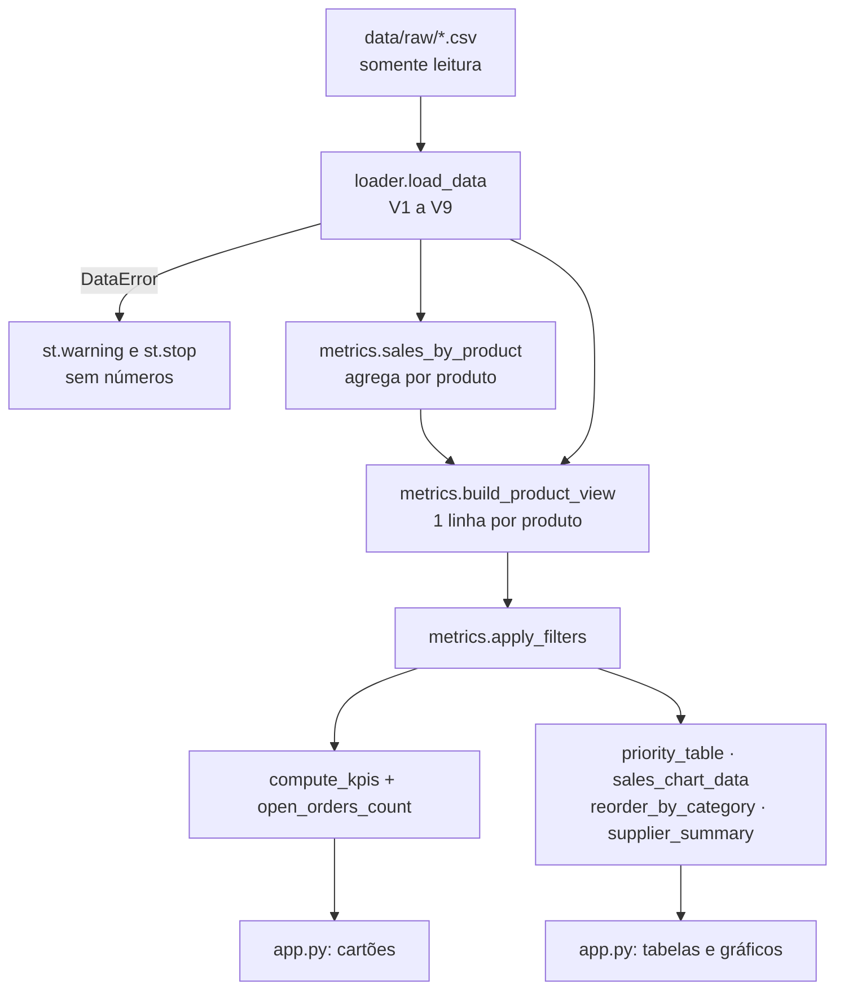

# SPEC: Software Specification

> **Objetivo:** transformar os requisitos do `PRD.md` em uma especificação verificável, que orienta a implementação e a validação do dashboard.
>
> **Documento de referência do SDD:** esta especificação é a fonte de verdade para os requisitos técnicos e comportamentais aprovados. Qualquer mudança de comportamento atualiza esta SPEC no mesmo PR do código.

## 1. Metadados

- **Projeto:** Garden Shop: Dashboard de Estoque e Reposição
- **Versão da especificação:** 2.0
- **Status:** Verified
- **PRD relacionado:** `PRD.md` (v2.0)
- **Responsável pela aprovação:** Lucas Girardi
- **Data:** 2026-11-01

Status permitidos: `Draft`, `In Review`, `Approved`, `Implemented`, `Verified`, `Deprecated`.

## 2. Objetivo técnico

Ler os CSVs da Garden Shop sem alterá-los, validar estrutura e integridade, calcular a visão por produto (estoque atual e vendas efetivas de um período) com status, déficit e prioridade de reposição, e exibir indicadores, filtros, gráficos e tabelas em um app Streamlit local. Limites: sem banco de dados, sem gravação de arquivos e sem previsões (não há histórico de estoque nem prazos de fornecedor).

## 3. Referências e rastreabilidade

| Requisito do PRD | Requisito da SPEC | Critério de validação |
|---|---|---|
| RF-020, RNF-001, RNF-002, RN-010 | REQ-001 Carga e validação | TEST-001, TEST-002, TEST-003, TEST-013 |
| RF-004, RN-001, RN-002, RN-007 | REQ-002 Vendas efetivas no período | TEST-004 |
| RF-005, RN-002 | REQ-003 Pedidos em aberto | TEST-010 |
| RF-001 a RF-003, RN-003, RN-005, RN-008, RN-009 | REQ-004 Visão por produto, status e reposição | TEST-005, TEST-006, TEST-008 |
| RF-011, RN-006 | REQ-005 Prioridade | TEST-006 |
| RF-007 a RF-010, RN-004, RN-007 | REQ-006 Filtros | TEST-007, TEST-009 |
| RF-001 a RF-006, RF-017 | REQ-007 Indicadores | TEST-009, TEST-011, TEST-013 |
| RF-011 a RF-015, RF-018, RF-019 | REQ-008 Tabelas e gráficos | TEST-009, TEST-011 |
| RF-006, RF-016 a RF-020, RN-011, RNF-004, RNF-005 | REQ-009 Interface, mensagens e cores | TEST-013 + conferência visual |
| RF-003 (formato) | REQ-010 Formatação de números | TEST-012 |
| CA-001 a CA-011 | (todos) | TEST-011 (base completa) e TEST-013 (interface) |

## 4. Escopo técnico

### 4.1. Incluído

- Carga de `products`, `categories`, `suppliers`, `orders` e `order_items`, com 9 validações (seção 7.2).
- Funções puras de cálculo em `garden_dashboard/metrics.py`.
- App Streamlit com 5 indicadores, 4 filtros, 2 gráficos (Altair), 3 tabelas e mensagens de estado vazio e de erro.
- Testes unitários, de integração com a base completa e da interface (`streamlit.testing.v1.AppTest`).

### 4.2. Excluído

- Leitura de `customers.csv` (dados pessoais, irrelevantes para reposição).
- Previsão, ponto de pedido, giro, cobertura e quantidade ideal de compra (PRD §5.2).
- Persistência, banco de dados, autenticação e deploy.
- Uso de `price`, `unit_price`, `shipped_date`, `coupon_code`, `customer_id` e `state`.

## 5. Arquitetura proposta

### 5.1. Visão geral

Arquitetura em três camadas: **carga** (lê e valida), **regras** (funções puras sobre DataFrames) e **interface** (Streamlit, sem fórmulas). Os dados originais ficam em `data/raw/` e são somente leitura.

### 5.2. Componentes

| Componente | Responsabilidade | Entradas | Saídas |
|---|---|---|---|
| `garden_dashboard/loader.py` | Ler os 5 CSVs, validar (V1 a V9) e tipar | Pasta de dados | `dict[str, DataFrame]` ou `DataError` |
| `garden_dashboard/metrics.py` | RN-001 a RN-009: vendas, visão por produto, status, prioridade, filtros, indicadores, tabelas | DataFrames, período, filtros | DataFrames e números |
| `garden_dashboard/formatting.py` | Moeda e inteiros no padrão brasileiro | Números | Textos |
| `app.py` | Filtros, layout, gráficos, mensagens e cores | Seleções do usuário | Tela |
| `tests/` | Verificação das regras, dos CSVs e da interface | Recorte e base completa | Resultado do `pytest` |

### 5.3. Fluxo de execução

1. `app.py` chama `load_data(DATA_DIR)` (com cache). Em caso de `DataError`, mostra o aviso e para.
2. Lê os filtros da barra lateral. O período padrão vem de `default_period(orders)`.
3. `build_product_view(dados, início, fim)` monta uma linha por produto.
4. `apply_filters(...)` aplica categoria, fornecedor e descontinuados.
5. `open_orders_count(...)` e `compute_kpis(...)` geram os indicadores.
6. `priority_table`, `sales_chart_data`, `reorder_by_category` e `supplier_summary` alimentam tabelas e gráficos.

### 5.4. Diagrama

## 6. Requisitos comportamentais

### REQ-001: Carga e validação

- **Origem:** RF-020, RNF-001, RNF-002, RN-010
- **Descrição:** o sistema deve ler os 5 CSVs necessários, validá-los e devolver DataFrames tipados, ou falhar com `DataError` no formato `"<arquivo>: <problema>"`.
- **Pré-condições:** pasta de dados acessível (padrão `data/raw/`, ou `GARDEN_DATA_DIR`).
- **Entrada:** arquivos CSV (seção 7.1).
- **Processamento:** validações V1 a V9 (seção 7.2). `status` e `discontinued` normalizados (espaços removidos, minúsculas). Datas no formato `AAAA-MM-DD`.
- **Saída:** `{"products", "categories", "suppliers", "orders", "order_items"}`. Sem `customers`.
- **Pós-condições:** arquivos de origem inalterados (abertos só para leitura).
- **Erros e exceções:** `DataError`. O app mostra `st.warning` e interrompe a tela.
- **Critérios de aceitação:**
  - Dado o recorte, quando carregado, então `products` tem 5 linhas, `discontinued` é booleano e `order_date` é data.
  - Dado `products.csv` ausente, quando carregado, então `DataError("products.csv: arquivo não encontrado …")`.
  - Dado um status `returned`, quando carregado, então `DataError("orders.csv: status desconhecido: 'returned'")`.

### REQ-002: Vendas efetivas no período

- **Origem:** RF-004, RN-001, RN-002, RN-007
- **Descrição:** o sistema deve somar as unidades de itens de pedidos `shipped`, `pending` e `processing` com `order_date` entre `start` e `end` (inclusive), por produto.
- **Entrada e saída:** `sales_by_product(orders, order_items, start, end) -> DataFrame[product_id, units_sold]`, com uma linha por produto vendido.
- **Regras aplicáveis:** cancelados excluídos. A agregação acontece antes de qualquer join (RN-008).
- **Critérios de aceitação:**
  - Dado o recorte e o ano de 2024, então Fiddle-Leaf Fig = 4, Pruning Shears = 1 (pedido 17 cancelado excluído) e Hand Cultivator = 2 (pedido 7 `pending` incluído).
  - Dado o período de 02/03/2024 a 01/05/2024 (bordas dos pedidos 1 e 7), então o total é 4 (as datas da borda são incluídas).

### REQ-003: Pedidos em aberto

- **Origem:** RF-005, RN-002
- **Descrição:** contar pedidos distintos `pending` ou `processing` no período com ao menos um item de um produto visível.
- **Entrada e saída:** `open_orders_count(orders, order_items, start, end, product_ids) -> int`.
- **Critérios de aceitação:**
  - Recorte, ano de 2024, produtos [1, 9, 11, 14] → 1 (pedido 7). Produtos [1, 14] → 0. Período a partir de 02/05/2024 → 0.
  - Base completa, filtros padrão → 6.

### REQ-004: Visão por produto, status e reposição

- **Origem:** RF-001 a RF-003, RN-003, RN-005, RN-008, RN-009
- **Descrição:** `build_product_view(data, start, end)` deve devolver **exatamente uma linha por produto**, com as colunas da tabela abaixo.

| Coluna | Fórmula |
|---|---|
| `category_name`, `supplier_name`, `contact_email` | joins N:1 (`validate="many_to_one"`) |
| `units_sold` | REQ-002 com left join; ausência = 0 |
| `stock_value` | `quantity_on_hand × cost` |
| `pct_level` | `quantity_on_hand ÷ reorder_level`; `NaN` se `reorder_level = 0` |
| `needs_reorder` | `not discontinued AND reorder_level > 0 AND quantity_on_hand ≤ reorder_level` |
| `deficit` | `max(reorder_level − quantity_on_hand, 0)`; 0 se descontinuado |
| `status` | primeira condição verdadeira: Descontinuado → Sem nível definido (nível = 0) → Zerado (estoque = 0) → Crítico (pct ≤ 0,50) → Abaixo do nível (pct ≤ 1,00) → Atenção (pct ≤ 1,25) → OK |
| `priority` | REQ-005 |

- **Erros e exceções:** se `len(view) ≠ len(products)` ou `product_id` repetido, gera `RuntimeError("Duplicação detectada…")`.
- **Critérios de aceitação:**
  - Limites: (0/10) Zerado · (5/10) Crítico · (6/10) e (10/10) Abaixo do nível e repor · (10/8) Atenção · (11/8) OK · (0/0) e (5/0) Sem nível definido, sem repor.
  - Fiddle-Leaf Fig: `stock_value` = 252, mesmo aparecendo em vários pedidos.

### REQ-005: Prioridade

- **Origem:** RF-011, RN-006
- **Descrição:** `mediana` = mediana de `units_sold` de todos os produtos ativos no período, calculada antes dos filtros de categoria e fornecedor.

| Status | Condição | Prioridade | Ordem |
|---|---|---|---|
| Zerado ou Crítico | — | P1 Urgente | 1 |
| Abaixo do nível | `units_sold ≥ mediana` | P2 Alta | 2 |
| Abaixo do nível | `units_sold < mediana` | P3 Média | 3 |
| Atenção | — | Monitorar | 4 |
| Descontinuado | — | Não repor | 5 |
| OK / Sem nível definido | — | — | 6 |

- **Critérios de aceitação:**
  - Vendas 5, 2, 3, 0 (mediana 2,5): Abaixo com 5 → P2, Abaixo com 2 → P3, Crítico → P1, Atenção → Monitorar.
  - Base completa: com o filtro só de Houseplants, Pothos continua P2.

### REQ-006: Filtros

- **Origem:** RF-007 a RF-010, RN-004, RN-007
- **Descrição:** `apply_filters(view, categories, suppliers, include_discontinued)` mantém as linhas com categoria **e** fornecedor selecionados e remove os descontinuados quando `include_discontinued = False`. O período **não** é aplicado aqui: ele já entrou em `units_sold`.
- **Regras aplicáveis:** lista vazia = nenhum produto. Se `start > end`, o app inverte as datas. Se só uma data for escolhida, `end = start`. O seletor de datas aceita o ano inteiro (01/01 a 31/12), para permitir períodos sem vendas.
- **Critérios de aceitação:** categoria inexistente → DataFrame vazio. Bird Feeder visível somente com `include_discontinued = True`.

### REQ-007: Indicadores

- **Origem:** RF-001 a RF-006, RF-017
- **Entrada e saída:** `compute_kpis(filtered, open_orders) -> {products_to_reorder, zero_stock, stock_value, units_sold, open_orders}`.
- **Regras aplicáveis:** soma de `needs_reorder`, contagem de `status = Zerado`, Σ `stock_value`, Σ `units_sold`. Visão vazia → todos os valores 0.
- **Critérios de aceitação:** recorte → `units_sold` = 7, `stock_value` = 460,50 (492,50 com descontinuados), a repor = 2, zerados = 1. Base completa → CA-001.

### REQ-008: Tabelas e gráficos

- **Origem:** RF-011 a RF-015, RF-018, RF-019

| Função | Saída |
|---|---|
| `priority_table(view)` | linhas com prioridade ≠ "—", ordenadas por (ordem, `pct_level`, nome) |
| `sales_chart_data(view)` | todos os produtos filtrados, inclusive com 0 vendas, por `units_sold` decrescente |
| `reorder_by_category(view)` | `category_name`, `products`, `to_reorder` |
| `supplier_summary(view)` | só itens com `needs_reorder`: `supplier_name`, `products`, `deficit_total`, `contact_email` (ausente = "não cadastrado") |

- **Critérios de aceitação:** todas as funções devolvem DataFrame vazio, sem exceção, para uma visão vazia. Recorte → prioridades [Hanging Basket, Hand Cultivator]. Ironwood Tools = [1, 7, "não cadastrado"].

### REQ-009: Interface, mensagens e cores

- **Origem:** RF-006, RF-016 a RF-020, RN-011, RNF-004, RNF-005
- **Descrição:** layout com a barra lateral de filtros, o cabeçalho (autor, período, cancelados excluídos, situação dos descontinuados), 5 cartões, cada um com o rótulo "Posição atual" ou "Período selecionado", a lista de prioridades em largura total e, abaixo, o gráfico de vendas à esquerda e, à direita, o gráfico de categorias e o quadro de fornecedores. Por fim, uma seção expansível com todos os produtos.
- **Mensagens:** sempre `st.info` / `st.warning`, nunca `st.error`.

| Situação | Mensagem |
|---|---|
| Visão filtrada vazia | "Nenhum produto encontrado para os filtros selecionados." (e para a tela após os cartões) |
| Total de vendas = 0 | "Sem vendas efetivas no período selecionado." |
| Nenhum `needs_reorder` | "Nenhum produto precisa de reposição nos filtros selecionados." |
| `DataError` | "Não foi possível carregar os dados: `<mensagem>`" (nenhum cartão exibido) |

- **Cores (sem vermelho):** Zerado `#3B3B3B` · Crítico `#D9822B` · Abaixo do nível `#E8B931` · Atenção `#7A9CC6` · OK `#4F9A6B` · Descontinuado `#A8A8A8` · Sem nível definido `#B9A6D6`. Tema com cor primária `#1F4E3D`, porque o padrão do Streamlit é vermelho. O menu "Deploy" fica oculto.
- **Gráficos:** eixos de produto e categoria com `labelOverlap=False` e altura por barra (`alt.Step`), para não esconder rótulos.
- **Critérios de aceitação:** TEST-013 (CA-001, CA-004 a CA-007, CA-011 pela tela, sem `st.error`) e conferência visual do print.

### REQ-010: Formatação de números

- **Origem:** RF-003
- **Descrição:** `brl_usd(4731) → "US$ 4.731,00"`, `brl_usd(0) → "US$ 0,00"` e `brl_int(1234) → "1.234"`. Os valores estão em dólar (dicionário), com separadores brasileiros.

## 7. Contratos de dados

### 7.1. Modelos de dados

Somente os campos abaixo são lidos e validados. Os demais são descartados na carga.

| Entidade | Campo | Tipo | Obrigatório | Restrições |
|---|---|---|---|---|
| products | `product_id` | int | Sim | PK, única |
| products | `product_name` | texto | Sim | não vazio |
| products | `category_id` | int | Sim | FK → categories |
| products | `supplier_id` | int | Sim | FK → suppliers |
| products | `cost` | float | Sim | ≥ 0 |
| products | `quantity_on_hand` | int | Sim | ≥ 0 (estoque **atual**) |
| products | `reorder_level` | int | Sim | ≥ 0 |
| products | `discontinued` | bool | Sim | `true`/`false`, sem diferenciar maiúsculas |
| categories | `category_id`, `category_name` | int, texto | Sim | PK única |
| suppliers | `supplier_id`, `supplier_name` | int, texto | Sim | PK única |
| suppliers | `contact_email` | texto | **Não** | ausente → "não cadastrado" na tela |
| orders | `order_id` | int | Sim | PK, única |
| orders | `order_date` | data | Sim | formato `AAAA-MM-DD` |
| orders | `status` | texto | Sim | `shipped`, `pending`, `processing`, `cancelled` |
| order_items | `order_item_id` | int | Sim | PK, única |
| order_items | `order_id` | int | Sim | FK → orders |
| order_items | `product_id` | int | Sim | FK → products |
| order_items | `quantity` | int | Sim | > 0 |

Relacionamentos: `categories 1─N products N─1 suppliers` e `orders 1─N order_items N─1 products`. A ligação `products ↔ order_items` é 1:N: um join direto repetiria o estoque a cada item vendido. Por isso as vendas são agregadas antes (RN-008, ADR-003).

### 7.2. Contratos de entrada e saída

- **Entrada:** CSV com cabeçalho, separador vírgula e UTF-8. Validações, na ordem:

| # | Verificação | Mensagem (exemplo) |
|---|---|---|
| V1 | Arquivo existe | `products.csv: arquivo não encontrado em data/raw` |
| V2 | Colunas obrigatórias presentes | `products.csv: colunas ausentes: reorder_level` |
| — | Campos obrigatórios não vazios | `products.csv: valor ausente em cost` |
| V4 | Números convertíveis, ≥ 0 e inteiros onde se espera inteiro | `products.csv: valor inválido em cost (linha do product_id 1)` |
| V5 | `quantity` > 0 | `order_items.csv: quantity deve ser > 0` |
| V3 | PK única | `orders.csv: order_id duplicado: 7` |
| V6 | `discontinued` booleano | `products.csv: discontinued inválido: 'sim'` |
| V7 | `status` conhecido | `orders.csv: status desconhecido: 'returned'` |
| V8 | `order_date` em `AAAA-MM-DD` | `orders.csv: order_date inválida: '02/03/2024'` |
| V9 | Integridade referencial | `order_items.csv: product_id sem produto correspondente: 99` |

- **Saída:** DataFrames tipados (seção 7.1). Nenhum arquivo é gravado.
- **Erros:** `garden_dashboard.loader.DataError(str)`, com mensagem pronta para o usuário.
- **Compatibilidade:** o dicionário diz `DD/MM/AAAA`, mas os arquivos usam ISO. Uma futura mudança de formato deve falhar em V8, e não ser interpretada errada (ADR-004).

## 8. Interfaces e integrações

### 8.1. Interface pública

- **Tela:** `streamlit run app.py` → http://localhost:8501 (REQ-009).
- **Funções públicas:** `loader.load_data`, `loader.DataError`, `metrics.default_period`, `sales_by_product`, `open_orders_count`, `build_product_view`, `apply_filters`, `compute_kpis`, `priority_table`, `sales_chart_data`, `reorder_by_category`, `supplier_summary`, `formatting.brl_usd` e `brl_int`.

### 8.2. Integrações externas

Nenhuma. O app funciona sem internet, exceto para instalar as dependências.

### 8.3. Configuração

| Item | Padrão | Uso |
|---|---|---|
| `GARDEN_DATA_DIR` (variável de ambiente) | `data/raw/` | Aponta outra pasta de dados (usada no TEST-013 para simular arquivo ausente) |
| `.streamlit/config.toml` | cor primária `#1F4E3D`, `toolbarMode = "viewer"`, `gatherUsageStats = false` | Tema sem vermelho, sem menu Deploy, sem telemetria |

Não há senhas, tokens ou credenciais.

## 9. Regras de negócio

### RN-001: Venda efetiva
- **Regra:** itens de pedidos `shipped`, `pending` e `processing`.
- **Exceções:** `cancelled` nunca conta.
- **Validação:** TEST-004 (Pruning Shears = 1 no recorte e na base).

### RN-002: Status `pending` e `processing`
- **Regra:** contam como venda e como pedido em aberto. `shipped` conta só como venda.
- **Validação:** TEST-004 e TEST-010.

### RN-003: Necessidade de reposição
- **Regra:** ativo, `reorder_level > 0` e `quantity_on_hand ≤ reorder_level`.
- **Exceções:** descontinuados e nível 0 nunca precisam de reposição.
- **Validação:** TEST-006 (limites 10/10 e 0/0).

### RN-004: Descontinuados
- **Regra:** nunca `needs_reorder`, nunca em RF-001/RF-002, prioridade "Não repor", ocultos por padrão.
- **Validação:** TEST-007 e CA-004.

### RN-005 e RN-006: Status e prioridade
- **Regra:** REQ-004 e REQ-005.
- **Validação:** TEST-006.

### RN-007: Período × posição atual
- **Regra:** o período filtra só pedidos.
- **Validação:** TEST-009 (julho: unidades 0, estoque inalterado) e CA-007.

### RN-008: Sem duplicação
- **Regra:** agregar as vendas por produto antes do join. Joins N:1 validados. Checagem de cardinalidade em `build_product_view`.
- **Validação:** TEST-008 (o join ingênuo daria 756 para o Fiddle-Leaf Fig no recorte. O correto é 252).

### RN-009: Déficit
- **Regra:** `max(nível − estoque, 0)`. É 0 para descontinuados.
- **Validação:** TEST-006 (Hand Cultivator 7, Hanging Basket 10).

### RN-010 e RN-011: Dados preservados e sem vermelho
- **Validação:** TEST-003 (hash) e TEST-013 (sem `st.error`), mais a conferência visual.

## 10. Requisitos não funcionais

- **Desempenho:** a tela completa carrega em menos de 3 s com a base da aula. A carga usa cache (`st.cache_data`).
- **Segurança:** sem dados pessoais na tela (`customers.csv` não é lido). Sem credenciais.
- **Confiabilidade:** dados inválidos interrompem a tela com uma mensagem clara, sem números parciais.
- **Observabilidade:** mensagens de erro identificam o arquivo e o problema (seção 15).
- **Acessibilidade:** a cor do status sempre vem acompanhada do texto.
- **Portabilidade:** Python 3.10+ em Windows, macOS e Linux.
- **Manutenibilidade:** regras só em `metrics.py`, com docstrings que citam o requisito (RN-xxx/RF-xxx).

## 11. Decisões técnicas

| ID | Decisão | Justificativa | Alternativas consideradas |
|---|---|---|---|
| ADR-001 | Streamlit + Altair | Dashboard interativo em Python puro, execução local simples, filtros nativos, testável com `AppTest` | Power BI (não versionável como código), Dash (mais código), notebook (sem interface de uso) |
| ADR-002 | pandas em memória, sem banco | Base pequena (menos de 100 linhas por tabela). Os CSVs originais ficam como fonte única | SQLite (camada extra sem ganho) |
| ADR-003 | Agregar as vendas por produto antes do join | Impede a duplicação de estoque e valor (RN-008) | Join direto e depois `drop_duplicates` (frágil, esconde erros) |
| ADR-004 | Datas lidas estritamente como `AAAA-MM-DD` | É o formato real dos arquivos. Um formato inesperado falha, em vez de trocar dia por mês sem avisar | Seguir o dicionário (`DD/MM/AAAA`) ou fazer inferência automática |
| ADR-005 | Mediana de prioridade calculada sem os filtros de categoria e fornecedor | A prioridade de um item não muda conforme o recorte | Mediana dentro do filtro (instável) ou limite fixo (arbitrário) |
| ADR-006 | Descontinuados ocultos por padrão, mas consultáveis | A tela principal fica focada em reposição, sem perder a visibilidade | Excluir de vez (perde informação) ou sempre mostrar (polui a lista) |
| ADR-007 | Tema verde e `st.warning` no lugar de `st.error` | Vermelho é reservado às correções do professor (RN-011) | Tema padrão do Streamlit (vermelho nos controles) |

## 12. Plano de implementação

Cada fase é uma branch com PR. Para regras de cálculo, o commit de testes vem antes do commit de implementação.

### Fase 1: Documentação (`docs/prd`, `docs/spec-agents`)
- **Objetivo:** PRD, SPEC, AGENTS e recorte manual dos CSVs com os resultados esperados.
- **Dependências:** dados e dicionário da Aula 1.
- **Verificação:** números da seção 13.1 conferidos à mão.

### Fase 2: Carga (`feat/loader`)
- **Objetivo:** REQ-001.
- **Dependências:** Fase 1.
- **Tarefas:** testes TEST-001 a TEST-003, depois `loader.py`.
- **Verificação:** `pytest tests/test_loader.py`.

### Fase 3: Regras (`feat/metrics`)
- **Objetivo:** REQ-002 a REQ-008 e REQ-010.
- **Dependências:** Fase 2.
- **Tarefas:** testes TEST-004 a TEST-012, depois `metrics.py` e `formatting.py`.
- **Verificação:** `pytest`. CA-001 a CA-010 na base completa.

### Fase 4: Interface (`feat/dashboard`)
- **Objetivo:** REQ-009.
- **Dependências:** Fase 3.
- **Tarefas:** `app.py`, tema, TEST-013.
- **Verificação:** `pytest`, `streamlit run app.py` e conferência visual.

### Fase 5: Revisão (`docs/revisao-final`, `docs/modelos-da-aula`)
- **Objetivo:** coerência entre documentos e código. Adaptação aos modelos da disciplina.
- **Verificação:** a checklist do AGENTS.md §7 e `pytest`.

## 13. Estratégia de testes

| ID | Cenário | Tipo de teste | Resultado esperado | Requisito |
|---|---|---|---|---|
| TEST-001 | Carga do recorte: tipos, normalização, `customers` não lido, e-mail nulo preservado | Unitário | 5 produtos, `discontinued` booleano, `PENDING` → `pending` | REQ-001 |
| TEST-002 | Arquivo ausente, coluna ausente, PK duplicada, status desconhecido, data em `DD/MM/AAAA`, booleano inválido, FK órfã, número negativo ou não numérico, quantidade 0 | Unitário | `DataError` com a mensagem da seção 7.2 | REQ-001 |
| TEST-003 | Hash dos arquivos de `data/raw/` antes e depois da carga | Integração | Hashes iguais | RN-010 |
| TEST-004 | Unidades por produto no recorte; cancelado; `pending`; bordas do período | Unitário | 4/1/2/0/0; total 7; período 02/03–01/05 = 4 | REQ-002 |
| TEST-005 | Valor do estoque no recorte | Unitário | 460,50; com descontinuados, 492,50 | REQ-004, REQ-007 |
| TEST-006 | Faixas de status nos limites exatos, nível 0, prioridade com mediana, déficit, prioridade estável com filtro | Unitário | Seção 6, REQ-004 e REQ-005 | REQ-004, REQ-005 |
| TEST-007 | Descontinuado abaixo do nível | Unitário | Não repõe, fora dos KPIs, "Não repor" no fim da lista | RN-004 |
| TEST-008 | Cardinalidade e produto em vários pedidos | Unitário | 1 linha por produto; Fiddle = 252 (join ingênuo = 756) | RN-008 |
| TEST-009 | Filtro sem resultado, lista de categorias vazia, julho sem vendas, produto sem vendas no gráfico | Unitário | Zeros e tabelas vazias sem exceção; estoque inalterado | REQ-006 a REQ-008 |
| TEST-010 | Pedidos em aberto por período e por produtos visíveis | Unitário | 1 / 0 / 0 | REQ-003 |
| TEST-011 | CA-001 a CA-010 e período padrão na base completa | Integração | Valores do PRD §6.5 | todos |
| TEST-012 | Formatação de moeda e inteiros | Unitário | `US$ 4.731,00`, `US$ 0,00`, `US$ 448,50`, `US$ 1.234.567,89`, `1.234` | REQ-010 |
| TEST-013 | Interface via `AppTest`: tela inicial, incluir descontinuados, Tools, RootWorks, julho, pasta sem arquivos | E2E (interface) | CA-001, CA-004 a CA-007 e CA-011 na tela; nenhum `st.error` | REQ-009 |

Arquivos: TEST-001 a TEST-003 em `tests/test_loader.py` · TEST-004 a TEST-010 em `tests/test_metrics.py` · TEST-011 em `tests/test_base_completa.py` · TEST-012 em `tests/test_formatting.py` · TEST-013 em `tests/test_app.py`.

### 13.1. Exemplos com resultado esperado (recorte verificado à mão)

`tests/fixtures/recorte/` tem linhas copiadas **sem alteração** dos CSVs originais: produtos 1, 9, 11, 14 e 24; pedidos 1, 7, 10, 17 e 18; apenas os itens desses pedidos que são desses produtos.

| Pedido | Data | Status | Itens (produto × qtd) |
|---|---|---|---|
| 1 | 2024-03-02 | shipped | Fiddle-Leaf Fig × 1 |
| 7 | 2024-05-01 | pending | Pruning Shears × 1, Hand Cultivator × 2 |
| 10 | 2024-02-28 | shipped | Fiddle-Leaf Fig × 1 |
| 17 | 2024-04-03 | **cancelled** | Pruning Shears × 1 |
| 18 | 2024-06-05 | shipped | Fiddle-Leaf Fig × 2 |

**Indicador validado 1: Unidades vendidas**

| Produto | Cálculo | Unidades |
|---|---|---|
| Fiddle-Leaf Fig | 1 (ped. 1) + 1 (ped. 10) + 2 (ped. 18) | 4 |
| Pruning Shears | 1 (ped. 7, pending) + ~~1 (ped. 17, cancelado)~~ | 1 |
| Hand Cultivator | 2 (ped. 7, pending) | 2 |
| Hanging Basket | sem vendas | 0 |
| **Total** (Bird Feeder oculto e sem vendas) | | **7** |

**Indicador validado 2: Valor do estoque a custo**

| Produto | Estoque × custo | Valor |
|---|---|---|
| Fiddle-Leaf Fig | 14 × 18,00 | 252,00 |
| Pruning Shears | 18 × 11,00 | 198,00 |
| Hand Cultivator | 3 × 3,50 | 10,50 |
| Hanging Basket | 0 × 6,00 | 0,00 |
| **Total (padrão)** | | **US$ 460,50** |
| + Bird Feeder (com descontinuados) | 4 × 8,00 | **US$ 492,50** |

**Demais verificações no recorte**

| Verificação | Esperado | Por quê |
|---|---|---|
| Produtos a repor | 2 (Hand Cultivator, Hanging Basket) | 3 ≤ 10 e 0 ≤ 10. O Bird Feeder (4 ≤ 6) é descontinuado |
| Produtos zerados | 1 | Hanging Basket |
| Pedidos em aberto | 1 | Pedido 7. O 17 é cancelado |
| Status | Fiddle OK (140%) · Shears OK (225%) · Cultivator Crítico (30%) · Basket Zerado · Bird Feeder Descontinuado | REQ-004 |
| Prioridade | Cultivator e Basket P1 · Bird Feeder "Não repor" | REQ-005 |
| Mediana de vendas | 1,5 (4, 1, 2, 0) | REQ-005 |
| Período 01/03 a 31/05/2024 | unidades 4 · em aberto 1 · valor 460,50 | RN-007 |
| Fornecedores | Ironwood Tools (1, déficit 7, "não cadastrado") · Terra Pots Co (1, déficit 10) | REQ-008 |

### 13.2. Base completa (`data/raw/`)

| Verificação | Esperado |
|---|---|
| Padrão | a repor 5 · zerados 1 · US$ 4.731,00 · unidades 86 · em aberto 6 |
| Mediana | 3 → Pothos (5) = P2 · Orchid Food (2) = P3 |
| Com descontinuados | US$ 4.763,00 · a repor 5 |
| Tools | a repor 1 · US$ 448,50 · unidades 5 |
| RootWorks Supply | sem produtos · indicadores 0 |
| Julho/2024 | unidades 0 · em aberto 0 · a repor 5 · US$ 4.731,00 |

### Cobertura de validação

- **Fluxos principais:** TEST-011 e TEST-013.
- **Limites e casos extremos:** TEST-006 (50%, 100%, 125%, nível 0) e TEST-004 (bordas do período).
- **Entradas inválidas:** TEST-002.
- **Falhas de integrações:** não se aplica.
- **Regressões:** a suíte completa roda em cada PR.
- **Requisitos não funcionais:** TEST-003 (integridade), TEST-013 (sem vermelho), mais a conferência visual.

## 14. Segurança e privacidade

- **Dados e ativos protegidos:** os arquivos originais (somente leitura) e os dados pessoais de `customers.csv`, que não são lidos.
- **Ameaças relevantes:** alteração acidental da base e exposição de dados pessoais na tela.
- **Controles de acesso:** não se aplica (uso local).
- **Armazenamento de segredos:** não há segredos.
- **Dados em logs:** o app não grava logs próprios.
- **Requisitos legais:** não se aplica (dados fictícios de exercício).

## 15. Observabilidade e operação

- **Logs:** os do Streamlit no terminal.
- **Métricas:** não se aplica.
- **Diagnóstico:** as mensagens de `DataError` dizem o arquivo e o problema. `pytest -v` mostra a regra que falhou.
- **Recuperação:** corrija o arquivo indicado (ou restaure-o do Git) e recarregue a página. Se mudar dados, use "Clear cache" no menu do Streamlit.
- **Execução:** `streamlit run app.py` para iniciar e Ctrl+C no terminal para encerrar.

## 16. Critérios de conclusão técnica

- Requisitos obrigatórios implementados. ✅
- Critérios de aceitação satisfeitos. ✅ (TEST-011 e TEST-013)
- Testes passando. ✅ (66 testes)
- Contratos validados. ✅ (TEST-001 a TEST-003)
- Nenhuma falha crítica conhecida. ✅
- Documentação reflete o comportamento implementado. ✅
- Instruções de execução testadas. ✅ (AGENTS.md §6)

## 17. Gestão de mudanças

Toda alteração relevante deve: (1) identificar o requisito afetado; (2) justificar a mudança; (3) avaliar o impacto em código, dados e testes; (4) atualizar os critérios de aceitação e os testes; (5) registrar uma nova versão na seção 19; (6) revisar a implementação e os testes afetados. Mudanças de escopo também atualizam o `PRD.md`.

## 18. Pendências

| ID | Descrição | Impacto | Responsável | Status |
|---|---|---|---|---|
| SPEC-OPEN-001 | Demanda reprimida: produto zerado sem vendas pode estar sem vendas por falta de estoque | Médio (prioridade pode subestimar itens em falta) | Lucas Girardi | Aberta. Depende de histórico (PRD DP-003) |
| SPEC-OPEN-002 | Comando de ativação do ambiente virtual no Windows não verificado | Baixo | Lucas Girardi | Aberta |

## 19. Histórico de versões

| Versão | Data | Alterações | Status |
|---|---|---|---|
| 1.0 | 2026-11-01 | Criação inicial, antes do código, a partir do PRD v1.0 | Approved |
| 1.1 | 2026-11-01 | Incluídas `default_period` e `brl_int`, surgidas ao escrever TEST-011 e TEST-012 | Implemented |
| 1.2 | 2026-11-01 | Incluídos o TEST-013 (`AppTest`), a variável `GARDEN_DATA_DIR`, a correção dos rótulos dos gráficos (descoberta na conferência visual) e a ocultação do menu Deploy | Implemented |
| 2.0 | 2026-11-01 | Reorganizada no modelo da Aula 2 (`templates/SPEC.md`): requisitos REQ-001 a REQ-010, rastreabilidade, ADRs, plano por fases e testes TEST-001 a TEST-013. **Nenhum comportamento mudou** | Verified |
